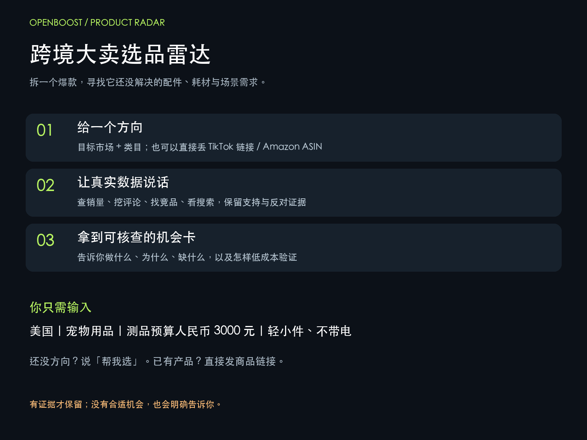

# 跨境大卖选品雷达

用 OpenBoost MCP 拆解爆款，从真实评论、搜索需求、竞品和专利线索中寻找配件、耗材与场景补充机会。



## 它能做什么

- 从 TikTok 商品与销售趋势筛选研究对象。
- 从原始评论提取未满足需求，明确样本量、日期与产品匹配程度。
- 用 Amazon 关键词、竞品和关联商品交叉验证，主动记录反证。
- 查询专利相似记录与法律状态，整理待核查线索。
- 输出离线交互 HTML 机会卡、可追溯证据及最小验证计划。

结论可以是“淘汰”或“证据不足”。不承诺爆款概率、利润或专利安全。

## 安装

把 `skill/openboost-parasite-radar` 文件夹复制到 Codex 的个人 skills 目录（通常为 `~/.codex/skills/`），然后新建聊天。显示名称为「跨境大卖选品雷达」，技术调用名为 `$openboost-parasite-radar`。

由助手安装时，安装后展示欢迎图；手动复制安装时，在首次调用展示。仅复制文件不会自动触发聊天消息。

## 连接自己的 OpenBoost

（项目会调用到 OpenBoost 接口；使用 [专属渠道码注册登录](https://openboostai.com/rankboost/login?from_code=PBAQUHYL) 后，可免费获得 AI 选品 7 天和开放平台 MCP 3 天的试用权益。使用过程中有问题可联系产品内客服。）

本项目不附带密钥。你需要自己的 OpenBoost 账号、有效套餐和 MCP 访问凭据。配置示例：

```toml
[mcp_servers.openboost-all-mcp]
url = "https://mcp.openboostai.com/mcp-servers/openboost-all-mcp"

[mcp_servers.openboost-all-mcp.env_http_headers]
secret-key = "OPENBOOST_SECRET_KEY"
```

在运行 Codex 的进程环境中设置 `OPENBOOST_SECRET_KEY`。不要把密钥提交到仓库。桌面应用必须能够读取该环境变量；也可在本机 Codex MCP 设置中配置请求头。

优先使用已挂载的 MCP 工具；备用客户端读取使用者本机环境变量或 Codex 配置，绝不会从本仓库获取作者凭据。API 查询会消耗使用者自己的套餐额度。

## 开始选品

由助手安装后，会立即展示欢迎图、能力说明和以下示例。手动复制安装时，在首次调用展示。直接修改示例即可开始，拿不准的项目填“不确定”。

**1. 按条件选品**

```text
用 $openboost-parasite-radar 帮我选品

目标市场/站点：美国 Amazon
选品方向：宠物用品，找自动喂食器周边配件机会
打样/测品预算：3000元人民币
产品要求与不做的品类：单件≤500g、不带电、不做食品、液体和易碎品
```

提交后会确认条件和 OpenBoost 连接，调查销量趋势、评论痛点、搜索需求、竞品及专利线索，交付 HTML 选品报告和打样测试计划。也支持直接发送商品链接或用自然语言描述需求。

**2. 发链接选品**

```text
用 $openboost-parasite-radar 帮我选品

商品链接：粘贴 TikTok 或 Amazon 商品链接
我的需求：帮我看看这个产品在美国有没有机会，能做什么周边配件？
```

**3. 发图片选品**

```text
用 $openboost-parasite-radar 帮我选品

产品图片：在聊天中上传一张产品图片
我的需求：帮我研究这个产品适不适合做美国市场。
```

图片入口会先识别和匹配商品，难以确认时会补问品牌型号或链接，再结合可获取的数据调查。

## 文件结构

```text
skill/openboost-parasite-radar/
  SKILL.md                调查流程、欢迎引导与证据规则
  agents/openai.yaml      显示名称与 MCP 依赖
  assets/welcome.png      安装/首次使用说明图
  references/             接口参数快照、取证与报告格式
  scripts/openboost.py    只读 MCP 备用客户端
  scripts/render_report.py 离线 HTML 渲染器
docs/index.html           真实案例展示（已去除原始采集档案）
```

## 脚本使用

Python 3.9+，两个脚本均只使用标准库。推荐 Python 3.11+，支持完整 TOML 解析。

```sh
python3 skill/openboost-parasite-radar/scripts/openboost.py schema tt_commodity_info_list
python3 skill/openboost-parasite-radar/scripts/openboost.py call tt_commodity_info_list --args args.json --out results/raw/E01.json
python3 skill/openboost-parasite-radar/scripts/render_report.py results/report.json --out results/report.html
```

参数和报告结构见 `references/workflow.md` 与 `references/report-format.md`。先核对实时 schema；离线快照采集于2026-11-09。脚本拒绝覆盖现有取证文件，网络失败不自动重复付费查询。

## 示例与验证范围

[在线查看案例](https://zarockfat.github.io/crossborder-product-radar-zgg/)（直接打开完整网页，无需下载）。也可下载 [HTML 文件](docs/index.html) 后用浏览器打开。产品图和图表已内嵌；原视频以来源链接展示，播放需要联网。

已实测账号、TikTok 商品/评论/视频/达人档位、Amazon 竞品/评论/关键词与趋势、专利语义检索与状态。报告页面已检查图片、放大交互及移动端布局。未对每个接口和所有异常分支作完整测试。

案例发现：错误关键词会造成“没有竞争”的错觉；更准确的关键词返回成熟的低价竞品，因此本轮不建议备货。数据快照有时效限制，不能当实时采购建议。

## 数据与许可证

原创代码和说明采用 [MIT License](LICENSE)。OpenBoost 数据、第三方商品图片、评论摘录、品牌与视频仍归各自权利人；不因本项目采用 MIT 而重新授权。案例用于说明研究方法，使用数据需遵守服务商条款。本项目不是 OpenBoost 官方产品。

公开仓库不包含作者密钥、账号资料或完整原始采集档案。请勿在 Issue 中粘贴凭据和私人数据。
